# Parte 1: Procesamiento de Datos no Estructurados

Mi idea en este ejercicio es usar Chatgpt como herramienta de apoyo. Voy a enviarle un prompt detallando el contexto del problema, los requisitos y las reglas que debe tener en cuenta a la hora de clasificar las reviews.

Prompt inicial: 

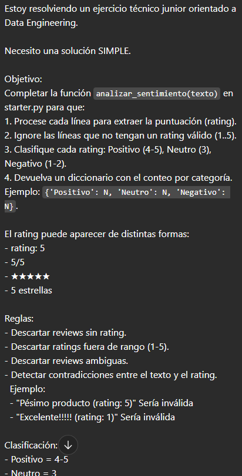
 
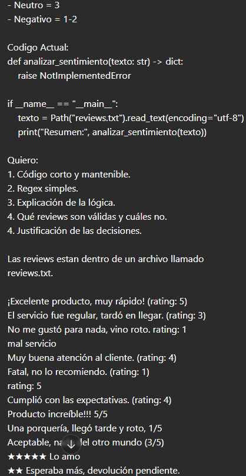
 
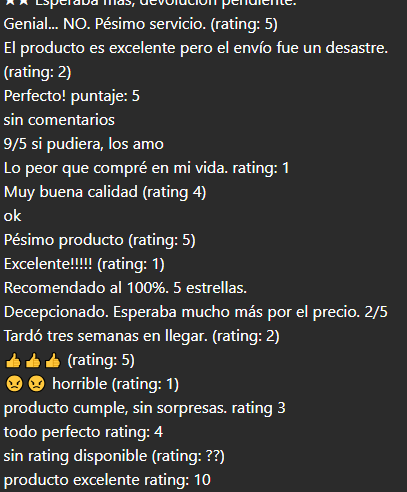

Primero lo pongo en contexto para explicarle mi situación y le escribo que es lo que necesito de él. Le aclaro que necesito una solución simple y facil de entender, además le detallo el objetivo tal como aparece en el PDF.

Luego le explico que el rating dentro del archivo puede aparecer de distintas maneras, no solo de forma númerica. Asi que le dejo unos ejemplos para que interprete correctamente mi pedido.

Después le escribo las reglas que debe contener una review. Decidí que las reviews ambiguas, fuera de rango, sin rating y que se contradicen van a ser descartadas. Le dejo unos ejemplos para que sepa a que me refiero. Además, le detallo la clasificación que uso.

A continuación le envío el codigo base, para que sepa por donde debe seguir y le detallo que es lo que busco en su respuesta.

Por último, le indico que las reviews se encuentran en reviews.txt y le copio todas las reviews actuales. De esta forma, tiene un contexto más detallado de lo que necesito y va a poder generarme una solución más exacta.

Al usarlo como herramienta busco un código conciso y comprensible, ya que lo que busco es aprender y resolver el ejercicio, de modo que si me hace un código perfecto pero que no entiendo no estaría cumpliendo con las reglas que le indiqué.

Su respuesta:

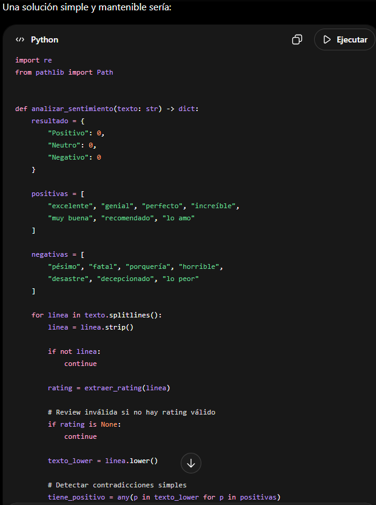

Empieza la función haciendo un dict que va a actuar como contador de reviews positivas, neutras o negativas. Luego, crea una lista llamada positivas, donde va a colocar palabras que suelen tener las reviews positivas de acuerdo a la información que le envié en mi prompt. Más adelante crea otra lista pero esta vez con palabras que suelen tener las reviews negativas.

Seguido a las listas empieza un bucle for, el cual busca recorrer texto (parámetro de la función) línea por línea. Ya que el enunciado pide procesar línea por línea, usa el método splitlines() para que cada línea represente una review y asi poder procesarlas individualmente. Con línea.strip() remueve los espacios vacíos al principio y al final de línea. 

Luego el código sigue con un if, el cual se ejecuta y pasa a la siguiente iteración si línea esta vacia.

Más adelante se ejecuta la función extraer_rating (la voy a explicar más adelante), a la cual se le pasa como parámetro una línea completa, que equivale a una review individual. Esta función analiza la review y extrae el rating correspondiente.En caso de que la review no contenga un rating válido la función devuelve None. Por esa razon hay un if que evalúa si rating es none, en caso positivo la iteración del for continúa.

El codigo sigue parseando a letra minúscula la review para poder compararla con las listas de palabras positivas y negativas creadas en un principio.

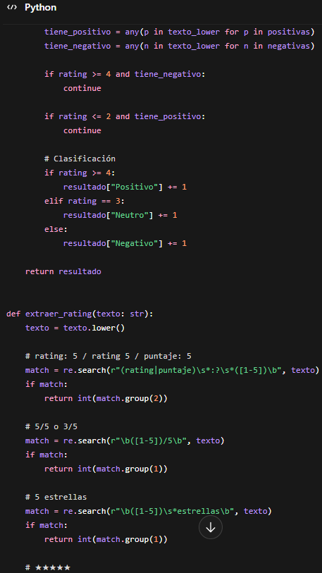

Si la review contiene una palabra que se encuentra en la lista de palabras positivas se guarda True en la variable tiene_positivo, en caso contrario se guarda False. Luego hace lo mismo con la lista de palabras negativas, guardando el resultado en tiene_negativo.

Gracias a la variable tiene_negativo puede comparar si una review es ambigua, ya que en el if siguiente pregunta si el rating es mayor o igual a 4 y si contiene una palabra negativa. De esa forma, las reviews que tienen rating alto pero contienen una review negativa son descartadas y el for continua evaluando la siguiente línea. Lo mismo ocurre en el caso de un rating bajo pero con una review positiva.

Finalmente, si la review llega al final del bucle for significa que es una review valida y se clasifica de acuerdo a su rating, sumando +1 en su categoría.

Por último, la función extraer_rating lo que hace es buscar el rating dentro de la review usando expresiones regulares. El rating no necesariamente es un valor numérico, sino que también puede ser un emoji. Por ese motivo, si la función no encuentra un rating válido devuelve None, indicando que la review tiene que descartarse.

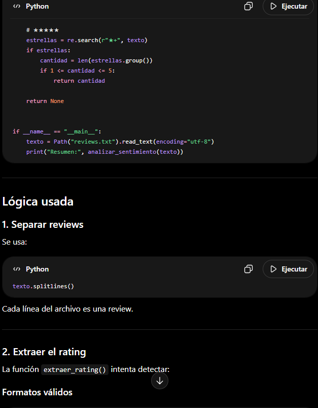

Luego guarda en la variable texto el contenido de reviews.txt. Y al final, ejecuta la función analizar_sentimiento pasandole como parámetro la variable texto.

Resto de la respuesta:

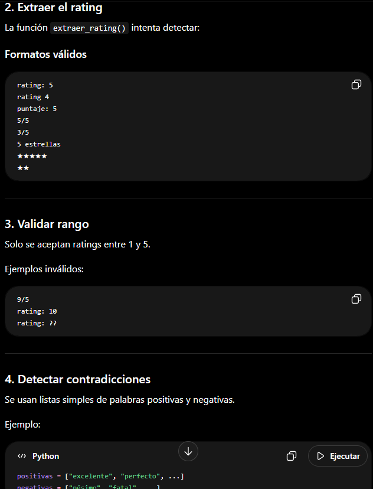
 

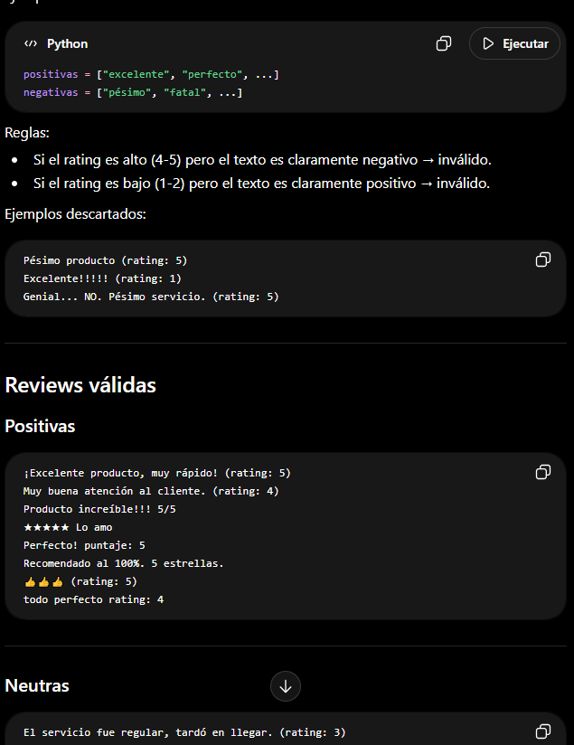
 

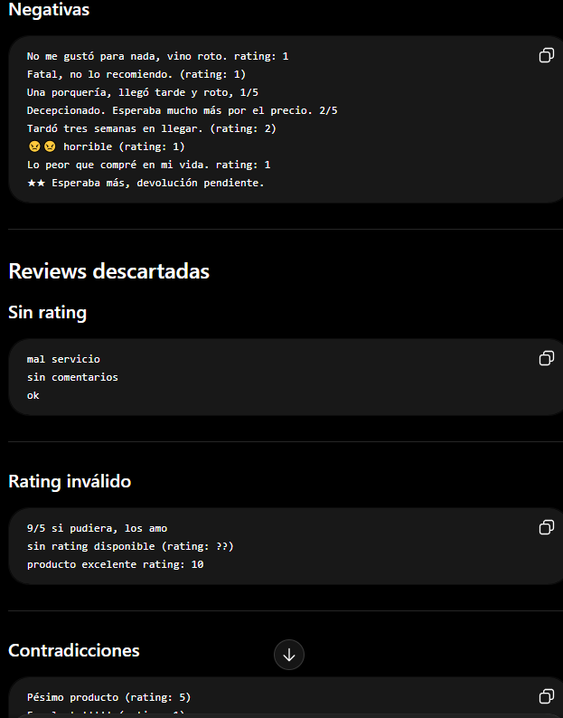
 

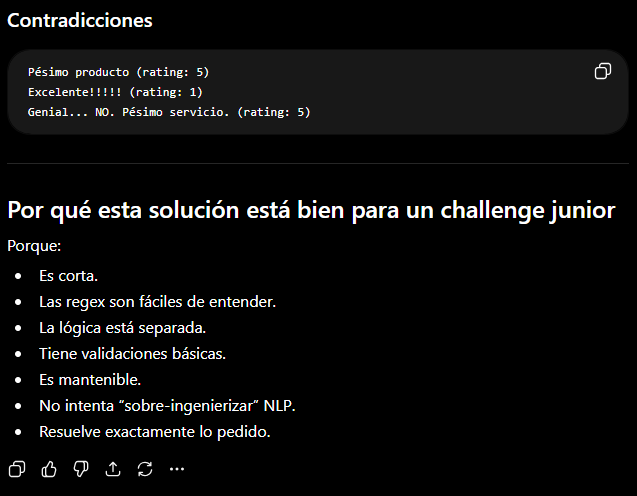

## Mis modificaciones:

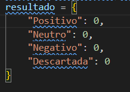

Agregué el resultado descartado para contar cuantas reviews son descartadas, ya que podria ser información útil para un futuro análisis.

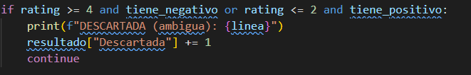

Mejoré la logica de descarte, dejando en un solo if ambas condiciones.

Además, agregue a lo largo del código prints para mejorar la trazabilidad, el debugging y la vista de los resultados.

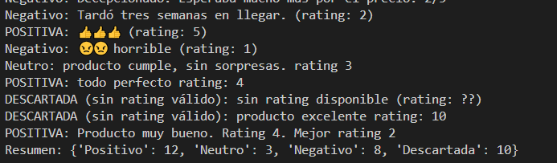

## Preguntas:
•Hay reviews donde el TEXTO y el RATING NO coinciden (ej: texto positivo con rating 1, o texto negativo con rating 5). ¿Cómo las tratás y por qué?

Las reviews que no coincide el texto con el rating las descarto, ya que lo que busco es obtener la información más limpia y consistente posible. El no descartarlas podrían generar una falsa clasificación y ruido en los resultados finales.

• Hay reviews con rating fuera del rango 1-5. ¿Las descartás, las clampeás, las contás? Justificá.

En este caso sigo el mismo criterio que en la respuesta anterior, las reviews que tienen un rating fuera de rango las descarto. Como el objetivo es trabajar con datos limpios y consistentes, modificar o asumir información que no cumple con mis parametros de validez podría generar inconsistencia.

• Si el texto trae más de una vez la palabra 'rating' o un número, ¿cómo decidís cuál es el rating real? Dejá un caso de prueba que pruebe tu lógica.

Ingrese la review "Producto muy bueno. Rating 4. Mejor rating 2"
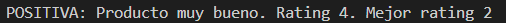

Por como Chatgpt estructuró la función extraer_rating, se tomaría como válido el primer valor que se encuentre en la review. Sin embargo, no estoy de acuerdo. 
En mi caso, modificaría la función para que si se encuentran 2 números o aparece la palabra rating 2 veces la review se descarte. Tomaría esa decision porque con dos valores estaría asumiendo información que no se si es correcta, y eso podria desencadenar en un error en los datos finales. 
